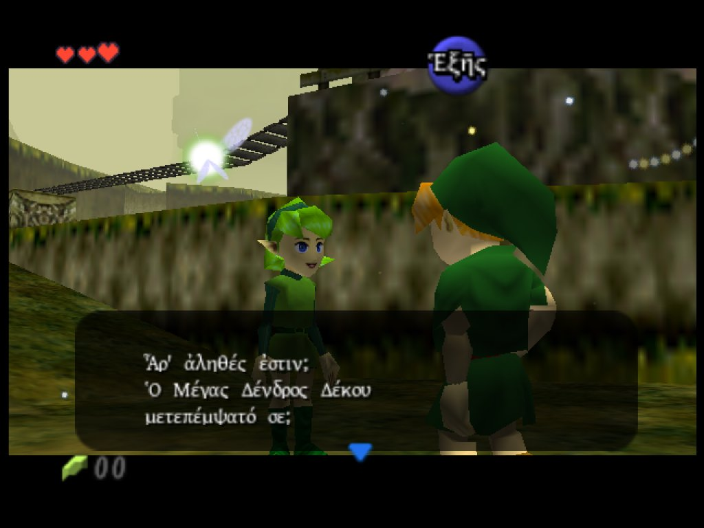
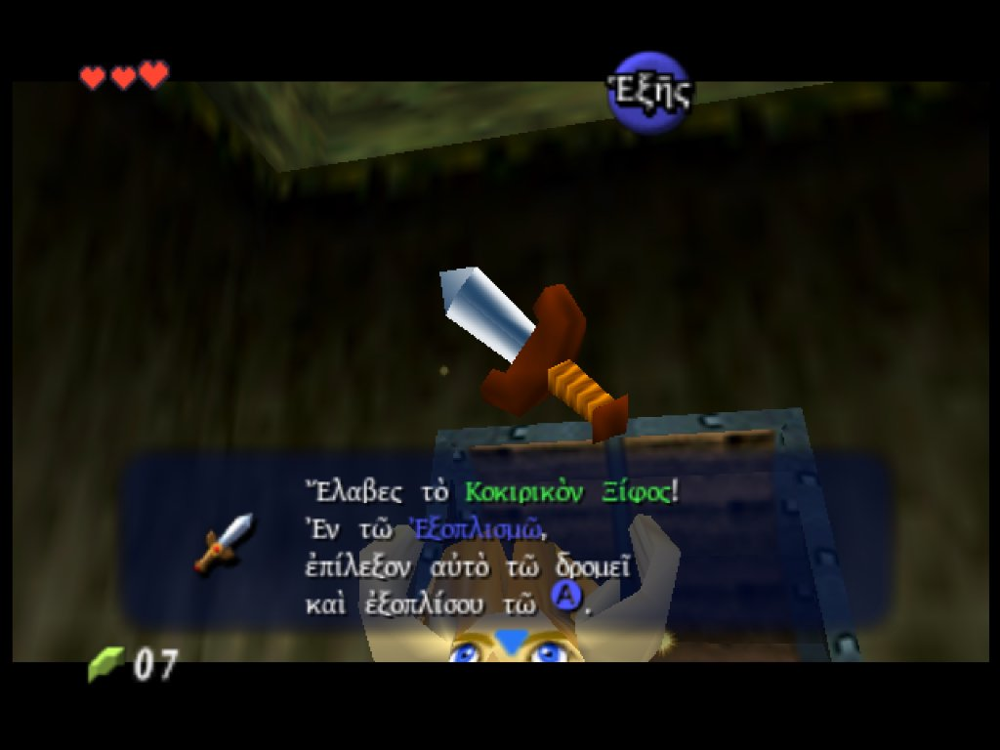
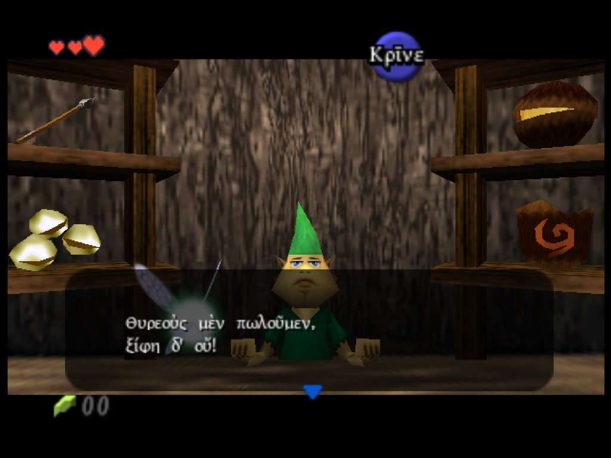

# The Legend of Zelda: Ocarina of Time — Ancient Greek Translation
### Ὁ Θρῦλος τῆς Ζέλδας: Ἡ Πλαγίαυλος τοῦ Χρόνου (Ἑλληνικὴ Μετάφρασις)

A complete, unabridged fan translation of **The Legend of Zelda: Ocarina of Time** (Nintendo 64, NTSC 1.2) into **Polytonic Ancient Greek** (Classical / Koine register), featuring a custom 224-glyph font based on SIL Gentium Plus, a dynamic proportional variable-width font engine, 265 translated graphical UI textures, 57 area entrance calligraphy cards, and all 2,075 dialogue messages and 48 staff credits.

---

## 📸 Screenshots

| Saria in Kokiri Forest | Obtaining the Kokiri Sword | Kokiri Shopkeeper |
|:---:|:---:|:---:|
|  |  |  |

---

## 🎮 How to Play (Applying the Patch)

Apply the `.bps` patch to a clean copy of the decompressed NTSC 1.2 ROM.

### Option 1: Web Patcher (No install needed)
1. Open **[Marc Robledo's Online ROM Patcher](https://www.marcrobledo.com/RomPatcher.js/)**.
2. Under **ROM file**, select your clean decompressed base ROM: `The Legend of Zelda - Ocarina of Time (USA) (Rev B)`.
3. Under **Patch file**, select `patches/zelda_ocarina_of_time_greek.bps`.
4. Click **Apply patch** and save your patched `oot_ancient_greek.z64` file.
5. Load into **RetroArch** (Mupen64Plus-Next core), **Ares**, or real N64 hardware with an EverDrive 64 / SummerCart64.

### Option 2: Desktop Patching Tools
* **Windows:** Use **[Flips (Floating IPS)](https://www.romhacking.net/utilities/1040/)**.
* **macOS / Linux:** Use **MultiPatch** or `flips`.

### Base ROM Specifications
Ensure your clean base ROM matches these checksums:
* **Base ROM:** `The Legend of Zelda: Ocarina of Time (USA) (Rev B / NTSC 1.2)` (Decompressed `.z64`)
* **File Size:** 55,046,144 bytes (~52.5 MB)
* **CRC32:** `5B38A451`
* **MD5:** `12fcafeba93992facaf65c2ba00f3089`
* **SHA-1:** `2411596acce5c81630bf2dfb839f2cf8f21cd3a1`

*Patched ROM Output:*
* **File Size:** 67,108,864 bytes (64.0 MB)
* **CRC32:** `CE546487`
* **CIC-6105 Checksum:** CRC1 = `0x2D908EEA`, CRC2 = `0x9B9C3A9D`

---

## ✍️ Translation & Lore Guidelines

* **Register:** High-classical and Attic-Koine synthesis reflecting the archaic antiquity of Hyrule.
* **Grammar:** Full polytonic Greek orthography (smooth and rough breathings, acute, grave, and circumflex accents, iota subscripts).
* **Glossary:** Consistent terminology across the Zelda universe (e.g. *Master Sword* = **Τὸ Κύριον Ξίφος**, *Triforce* = **Τὸ Τρίμορφον**, *Hyrule* = **Ἡ Ὑρούλη**, *Deku Tree* = **Ὁ Δένδρος Δέκου**, *Navi* = **Ἡ Νᾶβι**).
* For full vocabulary tables and grammatical rules, see the **[Ocarina of Time Translation Glossary](docs/ocarina_of_time_glossary.md)**.
* For controller mappings and action translations, see **[CONTROLS.md](docs/CONTROLS.md)**.

---

## 🛠️ Technical Details & N64 Architecture

### 1. 224-Glyph Gentium Plus Font & DMA Expansion
* **Font Expansion:** Expanded the original 144-tile `nes_font_static` (18,432 bytes) to **224 tiles** (28,672 bytes, covering bytecodes `0x20`–`0xFF`).
* **Hardware DMA:** Updated ROM `dmadata` entry `0x07AA0` so all 224 glyphs DMA cleanly into RDRAM across console hardware and modern low-level emulators without corruption.
* **Controller Buttons:** Preserved original N64 hardware symbols ([A], [B], [C-Up], [C-Down], etc.) at indices `0x9F`–`0xAA`.

### 2. Proportional Variable-Width Text Engine
* Replaced the game's hardcoded 144-entry character width table with a 224-float array in RDRAM (`0x8010C000`, ROM `0x00B81920`).
* Patched the MIPS `lwc1` instruction at ROM `0x00B4FFFC` (`lwc1 $f16, -0x4080($at)`), allowing characters `0x20`–`0xFF` to render with precise typographical kerning.

### 3. Dynamic Message Repacking & Pointer Table Recomputation
* Compiles all 2,075 dialogue messages and 48 staff credits dynamically into `nes_message_data_static` and `staff_message_data_static`.
* Recomputes all 32-bit segment pointers in `sNesMessageEntryTable` (`0x00B84A5C`) and `sStaffMessageEntryTable` (`0x00B88C7C`).
* Preserves critical system message IDs (`0xFFFC` / `0xFFFD`) to prevent save file and character entry glitches.

### 4. Seamless 2D Graphical Menu Textures
* **HUD Action Buttons (`do_action_static`):** Width-constrained action labels (Πλῆξον, Σκόπει, Ἄνοιξον, Πίσω, etc.) avoiding HUD overlap.
* **Solid Stone Pause Headers (`icon_item_nes_static`):** Procedural full-width stone beam synthesis across all 5 pause screens (`Ἐξοπλισμός`, `Σκεύη`, `Χάρτης`, `Ἀγών`, `Σῶσαι`), eliminating rectangular patch seams and preserving 100% alpha opacity.
* **Map & Area Names (`map_name_static`):** Translated world map points and subscreen banners (`Δρυμὸς Κοκίρι`, `Πεδίον Ὑρούλης`, etc.).
* **Place Title Cards:** 57 entrance calligraphy cards (`Δένδρος Δέκου`, `Κοιλία τοῦ Ἰαβοῦ-Ἰαβοῦ`, `Ναὸς τοῦ Χρόνου`, etc.) aligned to `dmadata` entries.

---

## 🏗️ Building from Source

To compile the ROM from source code and translation batches:

1. Place your clean decompressed `baserom-decompressed.z64` at `oot/baseroms/ntsc-1.2/baserom-decompressed.z64`.
2. Run the master ROM build script:
   ```bash
   python -m scripts.build_playable_rom
   ```
   This generates `oot_ancient_greek.z64` with valid CIC-6105 checksums.

3. To regenerate the BPS patch:
   ```bash
   python -m scripts.create_bps_patch
   ```

---

## 📁 Repository Structure

```
.
├── screenshots/
│   ├── 01_saria_dialogue.jpg             # Saria greeting Link in Kokiri Forest
│   ├── 02_kokiri_sword_item.jpg          # Obtaining the Kokiri Sword from the chest
│   └── 03_kokiri_shopkeeper.jpg          # Kokiri Shop dialogue & shopkeeper stelae
├── patches/
│   └── zelda_ocarina_of_time_greek.bps   # Complete BPS patch for NTSC 1.2
├── translations/
│   ├── batch_01_items.json               # Item & equipment descriptions
│   ├── batch_02_ui_shop.json             # Menus, system text & shopkeeper dialogue
│   ├── batch_03_bestiary.json            # Enemy check dialogue & combat advice
│   ├── batch_04_signs_songs.json         # Wooden signs, stone stelae & ocarina melodies
│   ├── batch_05_gossip_hints.json        # Gossip Stones & Sheikah hints
│   ├── batch_06_kokiri_forest.json       # Kokiri Forest NPCs & tutorial dialogue
│   ├── batch_07_deku_tree_woods.json     # Great Deku Tree & Lost Woods
│   ├── batch_08_ranch_zelda.json         # Lon Lon Ranch & Hyrule Castle courtyard
│   ├── batch_09_goron_death_mountain.json# Goron City & Death Mountain trail
│   ├── batch_10_zora_lake.json           # Zora's Domain & Lake Hylia
│   ├── batch_11_kakariko_sheik.json      # Kakariko Village, Graveyard & Sheik poetry
│   ├── batch_12_gerudo_spirit.json       # Gerudo Fortress & Desert Colossus
│   ├── batch_13_market_town.json         # Market alleys, castle town & dog lady
│   ├── batch_14_minigames_trade.json     # Minigames & Biggoron trading sequence
│   ├── batch_15_sages_finale.json        # Chamber of Sages, Ganondorf & ending sequence
│   └── batch_16_staff_credits.json       # Full staff credits & production team
├── scripts/
│   ├── build_playable_rom.py             # Master ROM repacker & CIC-6105 recalculator
│   ├── patch_menu_textures.py            # 265 graphical UI texture renderer & injector
│   ├── polytonic_map.py                  # Character-to-bytecode encoder & normalizer
│   ├── generate_font.py                  # 224-glyph font texture renderer
│   ├── patch_font_binary.py              # Font bytecode patcher
│   ├── verify_translations.py            # Message syntax & token validator
│   └── create_bps_patch.py               # Pure-Python BPS patch generator
├── fonts/
│   └── GentiumPlus-Regular.ttf           # SIL Open Font License polytonic Greek font
├── docs/
│   ├── ocarina_of_time_glossary.md       # Comprehensive terminology glossary & grammar rules
│   └── CONTROLS.md                       # Controller button layout & action verb reference
├── charmap_greek.txt                     # Full 224-character bytecode mapping
├── codepoints_greek.txt                  # Unicode codepoints table
└── README.md
```

---

## 📜 Credits & Acknowledgments

* **Translation & Engineering:** AncientGreekCI
* **Typography:** SIL International (*Gentium Plus* font, licensed under the OFL)
* **Decompilation Project:** [ZeldaRET / oot](https://github.com/zeldaret/oot) for reverse engineering and asset structure documentation
* **Original Masterpiece:** Nintendo EAD (1998)
